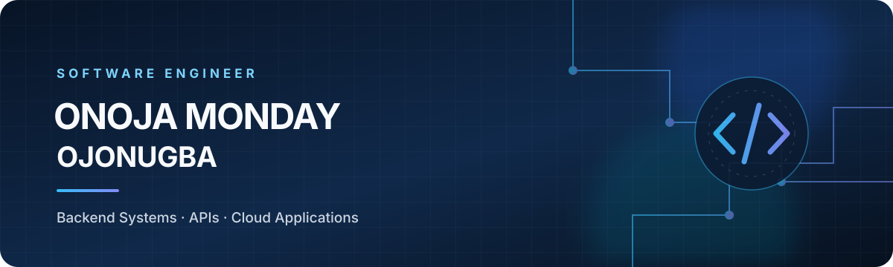
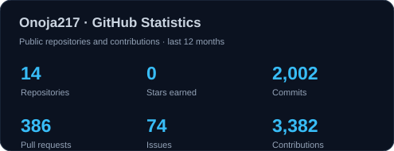
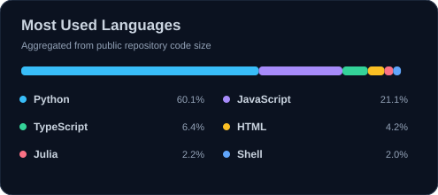
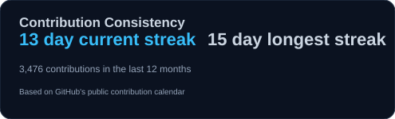
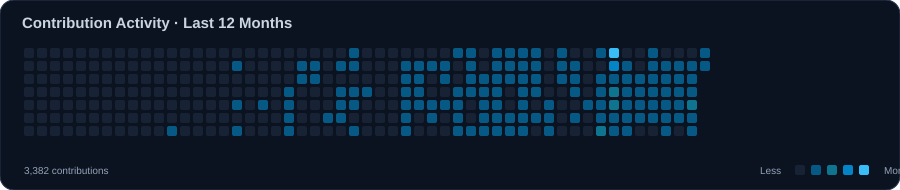

<!-- Profile README for github.com/Onoja217 -->

 

**I build practical software, backend services, and cloud-powered applications.**

---

## About

I'm a software engineer interested in building useful, dependable software and understanding the systems behind it. My work and learning focus on backend development, API design, databases, and modern web applications.

I enjoy taking a problem from an initial idea through implementation, testing, and deployment. I value clear technical decisions, maintainable code, and software that solves a genuine need.

- **Core languages:** Go, Python, and TypeScript
- **Focus areas:** Backend engineering, REST APIs, databases, and web applications
- **Engineering practice:** Git-based collaboration, debugging, testing, and deployment
- **Currently growing:** System design, cloud infrastructure, and production-quality application development

## Technology

  <strong>Languages</strong> 
  
  
  
  

  <strong>Frameworks &amp; Backend</strong> 
  
  
  
  
  

  <strong>Data &amp; Infrastructure</strong> 
  
  
  
  

  <strong>Tools</strong> 
  
  
  

## Selected Projects

<table>
  <tr>
    <td width="50%" valign="top">
      <h3>AIJE · Community Safety</h3>
      
A community-safety initiative exploring digital incident reporting, emergency communication, and coordinated local response.

      
<strong>Focus:</strong> Reporting workflows · Backend integration · Notifications

      <a href="https://github.com/Onoja217/AIJE-Development-Roadmap">Explore the project →</a>
    </td>
    <td width="50%" valign="top">
      <h3>Onoja.dev · Developer Portfolio</h3>
      
My personal portfolio for presenting selected work, engineering interests, and professional background.

      
<strong>Focus:</strong> Web development · Responsive design · Deployment

      <a href="https://onoja.is-a.dev/">Visit portfolio →</a>
    </td>
  </tr>
  <tr>
    <td colspan="2" valign="top">
      <h3>Stonez Digital · Software &amp; Digital Solutions</h3>
      
A digital solutions initiative focused on practical software, web platforms, and application experiences for real-world needs.

      
<strong>Focus:</strong> Software development · Web platforms · Application integration

      <a href="https://stonezdigital.com.ng/">Visit Stonez Digital →</a>
    </td>
  </tr>
</table>

## GitHub at a Glance

Public GitHub activity, language distribution, and contribution consistency, generated and hosted in this repository.

These cards are generated daily from GitHub's contribution and repository data. Language percentages represent public repository code size, not overall proficiency.
---

## Connect

I'm open to connecting with developers, contributing to meaningful projects, and exploring opportunities to grow as a software engineer.

<a href="https://onoja.is-a.dev/">Website</a> &nbsp;·&nbsp;
<a href="https://www.linkedin.com/in/onoja-monday-ojonugba-2084b3404/">LinkedIn</a> &nbsp;·&nbsp;
<a href="mailto:onojamondayojonugba@gmail.com">Email</a> &nbsp;·&nbsp;
<a href="https://github.com/Onoja217">GitHub</a>

  

*Curiosity drives the questions. Consistency builds the skill. Good engineering turns ideas into useful software.*

